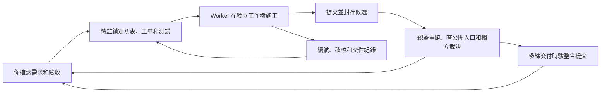

# cdx-DIRECTOR-WORKER

**cdxdw** 是 [DIRECTOR-WORK v2.6.0](https://github.com/scottpuppylu/DIRECTOR-WORK/tree/v2.6.0) 的獨立 Codex 版。你提出需求和驗收方式，Codex 總監把工作交給隔離的工作線，最後拿實際候選和驗收證據回來。中斷後可從工單、工作樹和紀錄接回。

**本文件適用於 `2.6.0-cdx.5` 候選。** 已發行版本可從 GitHub Releases 取得。用 `python -I -B -X utf8 tools/cdxdw.py --version` 核對你手上的套件，再選用對應文件。 [GitHub Releases](https://github.com/scottpuppylu/cdx-DIRECTOR-WORKER/releases) · [版本紀錄](CHANGELOG.md)

[五分鐘開始](#五分鐘開始) · [從交辦到驗收](#從交辦到驗收) · [中斷後怎麼接手](#中斷後怎麼接手) · [升級與回復](#升級與回復) · [指令速查](#指令速查) · [已知限制](#驗證與已知限制)

## 第一次讓 Codex 做專案

Codex 可以讀專案、改程式和執行工具。cdxdw 把一次聊天中的決定寫成可追蹤的工單。你可以關掉對話、換工作線，之後仍查得到核准範圍、交件版本和測試結果。

| 名詞 | 在這套流程裡的意思 |
|---|---|
| PO | 你或有權決定需求、授權和成品驗收的人。 |
| 總監 | 主要的 Codex 對話。負責拆工單、核准計畫、重跑驗收、回報待決事項。 |
| Worker | 接一張工單的施工工作線。提出計畫、修改範圍內的檔案、提交候選並交出證據。 |
| Reviewer | 依規格和候選 diff 獨立檢查，找出問題並交回總監裁決。 |
| Worktree | 同一 Git repo 的另一份工作目錄。施工與原本的工作目錄分開，Git 還能辨認它們屬於同一個專案。 |
| Base、候選與整合 SHA | Base 是施工起點。候選是單張工單提交的版本。整合 SHA 是多張工單合在一起後實際要驗的版本。 |
| AC、E2E 與工件 | AC 是單項驗收條件。E2E 從產品的公開入口走一遍。工件是實際交付的檔案，例如建置包或匯出的 CSV。 |



## 五分鐘開始

準備既有 Git 專案、Git、Python 3.9 以上，以及可開啟本機專案的 Codex。一般安裝與驗收工具由 Python 執行。若要使用 App Server、原生 Review 或線上診斷，還需要可用的 Codex CLI。候選版的原生協議實驗使用 CLI `0.160.1`。

### 方法一　在 Codex 貼上啟動提示詞

在 Codex 打開**你要開發的 Git 專案**，貼上下面這段。若要試候選功能，一併提供你手上 `.5` 套件或 checkout 的路徑。

```text
你是這個專案的 DIRECTOR-WORK 總監。使用 cdx-DIRECTOR-WORKER。
https://github.com/scottpuppylu/cdx-DIRECTOR-WORKER

若我尚未提供套件，先取得適用版本放在專案外，再讀 README.md、PURPOSE.md 和 BOOTSTRAP.md。問我選一般模式或小白模式，
先把第一版要做什麼、給誰用、怎樣算做到講清楚。核對活躍工作樹與未提交變更，
顯示 setup 計畫，再依本專案的授權完成建置。用繁體中文告訴我第一個待決、
交件方式及實際驗收入口。將我的回覆原文和對應版本寫進待決帳。
```

### 方法二　手動安裝到指定專案

在 **cdxdw 套件根目錄**執行。把 `$project` 換成要管理的 Git 專案完整路徑。第一個 `setup` 是預覽，確認專案與狀態目錄後再加 `--apply`。

```powershell
$project = 'D:\Projects\my-app'
python -I -B -X utf8 tools/cdxdw.py --version
python -I -B -X utf8 tools/cdxdw.py setup --repo $project --mode general --agents
python -I -B -X utf8 tools/cdxdw.py setup --repo $project --mode general --agents --apply
python -I -B -X utf8 tools/cdxdw.py doctor --repo $project --live
```

在 macOS、Linux 或 WSL 可用 `python3`，並將 `--repo` 輸入換成當地的專案絕對路徑。

- 預設狀態目錄是專案旁的 `DIRECTOR-<repo>`，可用 `--state` 指定另一個專屬目錄。安裝器會在 Git 共用目錄留一份指標，讓同 repo 的各工作樹找到同一套狀態。
- `--agents` 在專案 `AGENTS.md` 追加有標記的 cdxdw 區塊。需要原生 Hooks 時，加 `--hooks` 預覽再套用，並在 Codex 審查與信任。安裝、信任、實際命中各有自己的證據。
- 日常可用 Codex Desktop 工作。要讓 Git 建具名工作樹，使用 `work prepare`。已有從核准 base 開出的乾淨 Desktop worktree，使用 `work adopt` 登記。

[完整建置步驟](BOOTSTRAP.md) · [平台與沙箱診斷](docs/11_codex_operations.md) · [Codex Worktree 與交接](https://learn.chatgpt.com/docs/environments/git-worktrees)

### 選用 repo marketplace

套件提供五個按需使用的 Skill，涵蓋建置、派工、續航、審查、發版。專案 `setup` 會安裝 project skills。若想從 Codex 的本機 marketplace 選用，切到對應的 cdxdw 套件根目錄，執行下列指令或使用宿主的外掛管理介面。同一專案用一種入口即可避免重複的同名 Skill。建置工單狀態仍由 `setup` 完成。

```powershell
codex plugin marketplace add .
codex plugin add cdx@cdx-director-work
```

[外掛清單](.agents/plugins/marketplace.json) · [Codex plugin 封裝](https://developers.openai.com/plugins/build/plugins)

## 你平常會看到什麼

第一次開場會問 **一般模式或小白模式**。一般模式先盤點工作區、分支、Skill 和沙箱。小白模式先用三個問題定義需求、使用者和第一次如何試用。兩種模式用相同的工單與交件證據。 [需求到成品](docs/12_chat_to_product.md)

日常只需要說目標、回答待決、核對影響範圍、試用對應的成品。下面是首次交辦及待決紀錄的示意，實際工作時會附上工單與候選。

> 我要匯出訂單 CSV。欄位順序要固定，空結果也保留表頭。用一份兩筆訂單和一份空結果讓我驗收。

```text
OD-01  空結果的交付方式
A  匯出只有表頭的 CSV
B  顯示無資料訊息並結束
建議 A  方便既有報表程式辨認固定欄位
回覆方式  在聊天說「OD-01：A」
```

總監把回覆原文和來源寫入 `PO_PENDING.md`，將採用的決定及驗收記入專案紀錄。交件時報出候選、實際入口、通過項目和還需要你判定的項目。你要求修改時，保留當時你看的候選或建置工件，方便下一版重驗。 [待決範本](templates/PO_PENDING.md) · [成品裁決](templates/GATE_VERDICT.md)

## 從交辦到驗收

### 1. 確認初衷與工單

由總監用初衷卡保存需求及可觀察的完成條件。PO 核准後，將初衷設為 `LOCKED`，以 `work lock-brief` 固定快照。工單追溯到初衷條目時，依範本填入條目指紋。把 base 完整 SHA、可改路徑、禁止路徑及每項驗收的預期寫進工單。

| 治理級別 | 典型工作 | 重要驗收 |
|---|---|---|
| Direct | 查詢、簡單文件和容易回復的小改動 | 記清楚輸出與驗收。 |
| Standard | 一般功能、修復與可回退的工程改動 | 隔離工單、鎖測試、獨立規格審查、計畫核准和候選重跑。 |
| Strict | 資料格式、核心邏輯、對外介面、跨線整合和發版 | 綁定範圍、完整候選、證據與成品判定，並驗實際待交付組合。 |

[初衷卡](templates/BRIEF.md) · [工單範本](templates/WORK_ORDER.md) · [工單與品質閘門](docs/02_work_orders_gates.md)

### 2. 準備工作樹、派工和核准計畫

例如總監已把 `WO-001-export.md` 放在狀態目錄的 `orders/`。若基準版已有驗收腳本，用 `work --repo PROJECT lock-tests --base FULL_BASE_SHA tests/test_export.py` 產生測試指紋，再把結果填進工單。Standard／Strict 的獨立規格審查寫在 `reviews/WO-001-SPEC_REVIEW.md`。

Codex Desktop 工作樹要先開在核准 base，把實際工作樹路徑填進工單。以下用具名工作樹示範，Desktop 既有工作線可把第一個指令改成 `adopt`。

```powershell
$order = 'WO-001-export.md'
python -I -B -X utf8 tools/cdxdw.py work --repo $project prepare $order
python -I -B -X utf8 tools/cdxdw.py work --repo $project approve-spec $order --reviewer reviewer-1 --author director-1
python -I -B -X utf8 tools/cdxdw.py work --repo $project dispatch $order
```

將 `dispatch` 輸出的核准快照交給負責施工的 Codex 對話。總監審完 `work/WO-001/PLAN.md` 後，執行 `python -I -B -X utf8 tools/cdxdw.py work --repo $project approve-plan $order`。施工與驗收讀已派工快照，你可以另行編輯下版草稿。`.5` 也會分別保存各版的規格審查。 [規格審查範本](templates/SPEC_REVIEW.md) · [施工計畫範本](templates/WORKER_PLAN.md)

### 3. 封存候選並重跑

Worker 提交預期變更，把 `TASK_REPORT.md` 和驗收證據寫進 `work/WO-001/`。總監封存後使用輸出的完整 SHA，工具可從 Git ref 重建乾淨候選。

```powershell
python -I -B -X utf8 tools/cdxdw.py work --repo $project seal $order
$candidate = 'REPLACE_WITH_FULL_CANDIDATE_SHA'
python -I -B -X utf8 tools/cdxdw.py work --repo $project review $order --candidate $candidate --rerun
python -I -B -X utf8 tools/cdxdw.py session --repo $project native-review $order --candidate $candidate
```

- `review --rerun` 核對工單及候選範圍，重跑已在工單核准的 AUTO 指令。
- `native-review` 預覽封存 ref、base、候選及完整差異的 SHA-256。加 `--run` 才啟動 Codex 原生審查，且須先通過實體唯讀探針。結果是供總監裁決的審查紀錄。
- `work record --kind review` 保存獨立審查的判定。`work record --kind po` 保存 PO 對指定版本的判定。

[交件報告範本](templates/TASK_REPORT.md) · [原生 Review 與工具手冊](tools/CDX-TOOLS.md)

### 4. 走公開入口並判定交件

能用命令執行的公開入口，在派工前以 JSON 陣列寫入 `E2E_COMMAND`。例如 `["python", "-m", "my_app", "--smoke-test"]`，實際命令依專案調整。需要核對啟動參數時，再鎖定 `E2E_RUN_PLAN`。程式參照、啟動行及必填參數都要符合，才會採用結果。

```powershell
python -I -B -X utf8 tools/cdxdw.py work --repo $project e2e $order --candidate $candidate
python -I -B -X utf8 tools/cdxdw.py work --repo $project status $order --candidate $candidate
python -I -B -X utf8 tools/cdxdw.py work --repo $project final $order --candidate $candidate
```

有命令的工單需要最新的實際執行結果。瀏覽器或人工入口可用 `work record --kind e2e` 記錄操作者、環境、入口、預期、實際和判定。有建置工件時，用 `e2e --artifact-path` 取得工件 SHA-256，並在 `record`、`status` 及 `final` 指定同一個 `--artifact`。要求 REVIEW 或 PO 的工單要先取得相應判定。舊成功收據可回查，最新失敗會擋下放行。 [E2E、人工判定與工件參數](tools/CDX-TOOLS.md#初衷與最終驗收)

例如 PO 已親自試用指定候選並回覆接受，總監可依實際回覆登記。同一候選若交付多份工件，請把 `--artifact` 加到紀錄與放行命令。

```powershell
python -I -B -X utf8 tools/cdxdw.py work --repo $project record $order --candidate $candidate `
  --kind po --outcome PASS --actor 'project-owner' --environment 'Windows 11' `
  --entry 'Orders > Export CSV' --expected '兩筆輸出且空結果保留表頭' --observed '兩個案例皆符合，PO 回覆接受'
```

### 5. 多張工單合併交付

單張工單通過後，以 `work integrate` 固定目標分支與其 SHA，按實際採用順序提供兩個以上的 `--member ORDER.md=SHA`，用 `--argv` 指定核准的公開入口指令。工具會在暫存工作樹合併並驗收。單項有工件時，另以 `--member-artifact ORDER.md=HASH` 綁定。

```powershell
$targetSha = 'REPLACE_WITH_FULL_TARGET_SHA'
$secondSha = 'REPLACE_WITH_SECOND_CANDIDATE_SHA'
$entry = '["python","-m","my_app","--smoke-test"]'
python -I -B -X utf8 tools/cdxdw.py work --repo $project integrate `
  --target refs/heads/main --base $targetSha --member "$order=$candidate" `
  --member "WO-002-report.md=$secondSha" --argv $entry
```

發版前用 `work integration-status UUID --expect-head FULL_DELIVERY_SHA` 比對待交付提交。若遠端合併、rebase 或合併佇列產生新的 SHA，對該實際提交重跑驗收和 CI。用 [發版工具](tools/release.py) 之前也可先跑 dry run，核對預計的遠端操作。 [整合與發版手冊](tools/CDX-TOOLS.md#初衷與最終驗收) · [共用工具說明](tools/README.md)

## 中斷後怎麼接手

1. 在新對話請總監續接原專案，先核對 Git 共用目錄、工單 ID、派工版次和候選。
2. 用 `work status ORDER` 查工作線和下一步，再讀總監與 worker 的 `RESUME_STATE.md`、`PO_PENDING.md` 及最新交件紀錄。Desktop 交接前可封存需要保留的候選。
3. 若原工作來自 App Server，用 `session status ORDER --live` 和 `session reconcile ORDER` 查已知 thread／turn。工具可依原啟動記號找回遺失回應的回合，並標示由歷史回復的證據範圍。
4. 根據對帳結果繼續待做步驟。若要選用 `--reset-empty`，先核對宿主確實未接受該次啟動。工作樹已清理時，仍可從封存 ref 重建候選。

[續航手冊](docs/06_resume_lossless.md) · [交接範本](templates/HANDOFF.md) · [回合對帳](tools/CDX-TOOLS.md#中斷後對帳)

## Codex 特化與同系列比較

| 面向 | DIRECTOR-WORK／Claude Code | dshdw／DeepSeek Harness | agydw／Antigravity | cdxdw／Codex |
|---|---|---|---|---|
| 日常入口 | 角色、工單、Hook 與待決流程 | 對話提示詞、獨立工作線與事後查核 | Antigravity plugin 或啟動提示詞 | Desktop worktree、project skills／repo marketplace、App Server |
| 守門與取證 | 共用範本、驗收閘門、Claude Hook／紀錄工具 | 以主機紀錄核對實際工具使用 | 以原生 Hook、角色和工作區規則守門 | Codex Hook 信任、沙箱探針、回合及工具事件 |
| 候選與復工 | 以工單、Git 與嚴格的交接證據續接 | 以 DSH session 與工單證據續接 | 工作區、session 和稽核紀錄 | 派工快照、原生 turn 對帳、封存 ref、整合 SHA |

共用的治理工具包括需求追溯、範圍檢查、測試指紋、證據重跑、決策紀錄與發版乾跑。`.5` 將候選、工件、最近一次 AUTO／E2E 嘗試和整合收據串到交件流程。原版的 run-plan 也可鎖定 Codex 工單的公開入口參數。 [原版](https://github.com/scottpuppylu/DIRECTOR-WORK/tree/v2.6.0) · [dshdw](https://github.com/scottpuppylu/dsh-DIRECTOR-WORKER) · [agydw](https://github.com/scottpuppylu/agy-DIRECTOR-WORKER) · [同系列研究](research/CDXDW-2026-11-24-INDEPENDENT-REVIEW.md)

## 防護與證據怎麼讀

| 機制 | 查得到什麼 | 必要條件 |
|---|---|---|
| 具名或登記的 Git 工作樹 | Git 歸屬、base、提交、可查的候選 ref | 採用已確認的工單與實際 checkout。 |
| Hook | 依宿主支援的工具攔截已知規則，記錄已觀察的事件 | 安裝後須由 Codex 信任。用 `doctor --live` 查載入狀態。 |
| 實體沙箱 | App Server 執行路徑是否達到要求的寫入限制 | 用 `doctor --live --probe-sandbox` 檢查。Windows 自動回合另查 readiness。 |
| 稽核和用量 | 已觀察的命令終態、退出碼、回合及 token 計數 | 回合完成、命令成功、成品通過和實際帳單各有不同證據。 |
| 候選與整合閘門 | 本次工單、候選、工件、最新驗收與待交付 SHA 是否一致 | 以總監取得的實際執行或清楚歸屬的人工結果判定。 |

一般 AUTO 與命令 E2E 在候選的暫存副本執行，並使用篩選過的環境變數。已核准的唯讀 Git 檢查可在候選工作樹讀取歷史。這些本機檢查仍受執行宿主的檔案權限控制。需要隔離的程式應由具備合適權限邊界的執行環境驗證。 [安全原則](docs/08_safety_rules.md) · [施工閘門](docs/13_safety_gates.md) · [Codex 沙箱與核准](https://learn.chatgpt.com/docs/agent-approvals-security)

## 升級與回復

1. 結束舊 runtime 正在執行的命令，保存目前專案與狀態資料的備份。確認同一張工單只由一個 runtime 寫入。
2. 用新版套件跑 `setup --repo PROJECT` 預覽，確認原狀態目錄後加 `--apply`。安裝保留舊 runtime，供查閱原始格式與規則。
3. 既有工作樹用 `work sync-worker ORDER` 更新 cdxdw 管理的 Skill 和 Hook，再查宿主載入及信任。遇到無法辨識的本機 Skill，先核對它的來源。
4. 舊版收據依原格式保留。若顯示 `LEGACY_NEEDS_VERIFICATION`，以新版重跑或補登判定。遇到需要回復的情況，採用已核對的備份，並比對未提交改動、候選 refs、待決原文和 journal。

[升級細節](tools/CDX-TOOLS.md#升級) · [升級與回復重現](research/reproduce_cdxdw.py)

## 指令速查

從 cdxdw 根目錄以 `python -I -B -X utf8 tools/cdxdw.py` 執行下列指令。安裝後也可從專案狀態中的版本化 runtime 執行。`tools/cdx.py` 是相容入口。

| 你現在要做的事 | 指令 |
|---|---|
| 預覽安裝或升級 | `setup --repo PROJECT`，確認後加 `--apply` |
| 查 Skill、Hook、沙箱 | `doctor --repo PROJECT --live --probe-sandbox` |
| 凍結 PO 核准的初衷 | `work --repo PROJECT lock-brief` |
| 建立或登記工作線 | `work --repo PROJECT prepare ORDER` 或 `work --repo PROJECT adopt ORDER` |
| 審草稿、派工、核准計畫 | `work approve-spec`、`work dispatch`、`work approve-plan` |
| 看工單及續接位置 | `work status ORDER` |
| 同步既有 worker 與封存候選 | `work sync-worker ORDER`、`work seal ORDER` |
| 審查指定候選 | `work review ORDER --candidate SHA --rerun` 或 `session native-review ORDER --candidate SHA` |
| 執行入口、登錄判定和放行 | `work e2e`、`work record`、`work final` |
| 驗收多線組合 | `work integrate`、`work integration-status UUID --expect-head SHA` |
| 對帳 App Server 回合 | `session status ORDER --live`、`session reconcile ORDER` |
| 查稽核鏈和用量 | `audit verify LOG`、`audit status LOG`、`usage LOG` |

`work` 與 `session` 的 `--repo PROJECT` 放在子命令之前，未指定時讀目前目錄。完整參數見 [cdxdw 工具手冊](tools/CDX-TOOLS.md)。

## 檔案地圖

| 路徑 | 讀者會在這裡找到 |
|---|---|
| [PURPOSE](PURPOSE.md) · [BOOTSTRAP](BOOTSTRAP.md) | 初衷、角色責任與第一輪建置。 |
| [角色與權限](docs/01_roles_authority.md) · [溝通與待決](docs/03_communication.md) · [續航](docs/06_resume_lossless.md) · [安全](docs/08_safety_rules.md) | 每輪應核對的工作規則。 |
| [用量](docs/04_quota_efficiency.md) · [模型](docs/05_models_effort.md) · [按需程序](docs/06b_on_demand_procedures.md) · [品質](docs/07_quality_gates.md) | 選型、成本、觸發的特殊流程和審查標準。 |
| [記憶](docs/09_memory.md) · [教訓](docs/10_lessons_learned.md) · [Codex 操作](docs/11_codex_operations.md) · [需求到成品](docs/12_chat_to_product.md) · [安全閘門](docs/13_safety_gates.md) | 知識沉澱、平台操作與實務驗收。 |
| [範本](templates/) · [平台工具](tools/CDX-TOOLS.md) · [共用工具](tools/README.md) · [外掛](plugin/cdx/) | 人與自動化共同採用的輸入、命令和 Skill。 |
| [移植報告](CODEX-PORT.md) · [平台研究](research/CODEX-PLATFORM.md) · [獨立研究](research/CDXDW-2026-11-24-INDEPENDENT-REVIEW.md) · [逐檔清單](research/CDXDW-2026-11-24-FILE-REVIEW.md) | 移植對照、實際驗證、閱讀範圍與歷史差異。 |
| `DIRECTOR-<repo>/` | 專案狀態、PO 帳、派工與版本快照、工作線、證據、收據、稽核及 runtime。 |

## 驗證與已知限制

| `.5` 候選驗證項目 | 已取得的證據 |
|---|---|
| cdxdw 自檢 | Windows 及 WSL Ubuntu 各 12/12 通過。 |
| 上游相容性 | WSL 3,140/3,140 通過，另依平台略過 1 個 Windows 專用案例。 |
| 原生 Review | 實際 Codex CLI 搭配本機固定回覆，驗證跨兩個提交的範圍和審查終態。 |
| 安裝、升級與回復 | 隔離專案完成 `.3 → .4 → .5`、備份回復至 `.4`，比對候選 refs、PO 原文、journal 和未提交工作。 |
| 發版演練 | 暫存 clone 與本機 bare remote 上完成 dry run，核對預計操作與遠端 refs。 |

```powershell
python -I -B -X utf8 tools/selftest_cdx.py --verbose
python -I -B -X utf8 tools/selftest.py
python -I -B -X utf8 research/reproduce_cdxdw.py
python -I -B -X utf8 research/probe_app_server.py --native-review
```

Windows 的物理唯讀探針在研究環境未通過。真實模型審查、Desktop Handoff、受信任 Hook 的實際事件覆蓋及實際交付 SHA 的遠端 CI 仍待驗證。安裝、工單預覽與本機證據檢查可先使用。 [實驗及重現詳情](research/CDXDW-2026-11-24-INDEPENDENT-REVIEW.md)

## 常見問題

**每件事都要開新工作樹嗎？** 簡單查詢或文件工作可用 Direct。一般功能、可回退的程式改動及跨線整合，再依 Standard／Strict 使用隔離工作線與完整候選驗收。

**關掉 Codex 還找得到進度嗎？** 先查工單的派工快照、`work status` 和斷點資料。App Server 工作可再由宿主歷史對帳。已封存候選可以從 Git ref 重建。

**為什麼 exit 0 還顯示 INVALID？** 有鎖定 run-plan 時，啟動行及必要參數也要符合。先查該次公開入口的輸出、程式參照和實際使用的工件。

**哪些指令會送模型回合？** `session run` 和 `session native-review --run` 會啟動模型回合。一般本機工具、原生 Review 預覽與指定候選的公開入口重跑由本機處理。若專案自己的驗收指令呼叫外部服務，其用量依該指令和專案授權。

**我要怎麼判定交付可以用？** 讓總監指出實際待交付 SHA 或工件、已通過的獨立檢查、剩餘待決，以及你可親自重走的入口。合併多張工單時核對整合版的證據。 [品質閘門](docs/07_quality_gates.md)

## 授權

[MIT](LICENSE)。上游初衷、共用格式與歷史見 [PURPOSE](PURPOSE.md) 及 [上游版本紀錄](CHANGELOG-upstream.md)。
