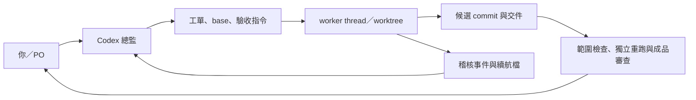

# cdx-DIRECTOR-WORKER

這是 **cdx-DIRECTOR-WORKER**（簡稱 **cdxdw**，版本 `2.6.0-cdx.2`）。讓 Codex 當專案總監，把你的需求拆成工單，讓每條施工線在獨立 Git worktree 工作，最後由總監針對交件 commit 重跑驗收。關掉對話或重啟程式後，可以用工單、thread ID 和續航檔接回進度。

cdxdw 是 [DIRECTOR-WORK v2.6.0](https://github.com/scottpuppylu/DIRECTOR-WORK/tree/v2.6.0) 的獨立 Codex 移植。它與 [dshdw](https://github.com/scottpuppylu/dsh-DIRECTOR-WORKER)、[agydw](https://github.com/scottpuppylu/agy-DIRECTOR-WORKER) 共用工單、閘門和證據格式，各自使用平台的原生能力。平台工具和版本後綴用 `cdx`。用 Git、Python 和 Codex 就能開始。

## 它怎麼運作

| 角色 | 做什麼 |
|---|---|
| 你（PO） | 說明要做的事，確認初衷、影響使用者的決策、公開或付費，最後驗收成品 |
| Codex 總監 | 寫工單、鎖定驗收條件和派工版次、決定是否退回，親自重跑驗收 |
| Worker | 在自己的工作樹擬計畫、實作、跑測試，交付 commit 和證據 |
| 獨立 reviewer | 讀規格與候選 diff，檢查功能、邊界和風險。需要執行上唯讀時，先驗證沙箱 |



## 五分鐘開始

需要 Git、Python 3.9 以上及本機 Codex。原生 App Server 路徑以 Codex CLI `0.160.1` 驗證。先在你的 Git 專案開一個本機 Codex 對話，再把下列提示詞貼給它。

```text
你是這個專案的 DIRECTOR-WORK 總監。使用 cdx-DIRECTOR-WORKER：
https://github.com/scottpuppylu/cdx-DIRECTOR-WORKER

先讀 README.md、PURPOSE.md 和 BOOTSTRAP.md。問我選一般模式或小白模式，
然後照 BOOTSTRAP.md 建置。先顯示 setup 的計畫，保留專案現有設定與資料，
用繁體中文回報目錄、驗證結果和下一步。先談需求，把初衷、工單範圍與驗收寫清楚。
公開、推送、付費、刪除、覆寫或修改帳號設定，依我對本專案的授權處理。
```

也可以手動開始。從 **cdxdw 的目錄** 執行，將 `PROJECT` 改成既有 Git 專案的完整路徑。

```powershell
python -I -B -X utf8 tools/cdxdw.py setup --repo PROJECT
python -I -B -X utf8 tools/cdxdw.py setup --repo PROJECT --apply --agents
python -I -B -X utf8 tools/cdxdw.py doctor --repo PROJECT --live
```

預設在專案旁建立 `DIRECTOR-<repo>/`。`--agents` 追加一個有標記的區塊到專案 `AGENTS.md`。需要工具守門、Hook 稽核與壓縮後提示時，執行 setup 加 `--hooks`，再在 Codex 的 Hook 審查介面信任它。完整的安裝選項、首輪回報和路徑見 [BOOTSTRAP.md](BOOTSTRAP.md)。

## 一張工單

總監以 [WORK_ORDER](templates/WORK_ORDER.md) 建立 `WO-001-export.md`，列出 `BASE_REF`、具名分支、絕對 worktree、工作目錄、可改檔案、禁止路徑及 AUTO 指令。環境或專案適合 Desktop 手動施工時，把這份工單交給那個 checkout 的 Codex 對話。App Server 也有可程式化的路徑。

```powershell
python -I -B -X utf8 tools/cdxdw.py work --repo PROJECT prepare WO-001-export.md
python -I -B -X utf8 tools/cdxdw.py work --repo PROJECT approve-spec WO-001-export.md --reviewer REVIEWER_ID --author DIRECTOR_ID
python -I -B -X utf8 tools/cdxdw.py work --repo PROJECT dispatch WO-001-export.md
python -I -B -X utf8 tools/cdxdw.py session --repo PROJECT new WO-001-export.md
python -I -B -X utf8 tools/cdxdw.py session --repo PROJECT run WO-001-export.md --phase plan
```

總監把核准計畫記為 `work/WO-001/PLAN.md`，執行 `work approve-plan`，再以 `session run … --phase implement` 施工。中斷後用 `session status … --live` 和 `session reconcile …` 檢查是否曾經啟動，並讀取 `RESUME_STATE.md`。

Worker 交出 `TASK_REPORT.md`、報告中的候選 commit 及 `work/WO-001/evidence/`。總監用以下入口綁定候選，檢查範圍、報告及證據，並重新執行工單中核准的 AUTO 檢查：

```powershell
python -I -B -X utf8 tools/cdxdw.py work --repo PROJECT review WO-001-export.md --candidate FULL_COMMIT_SHA --rerun
```

`REVIEW` 條件由獨立審查與成品檢查處理。`PO` 條件由你確認後記入裁決。測試、審查和 PO 驗收各有自己的證據。

## 該從哪個模式開始

- **小白模式** 把重點放在「想看到什麼」和可試的第一版。先寫初衷卡與待決帳，談完需求再建立完整工作線。
- **一般模式** 先盤點 repo、技能、沙箱和工作線，再定第一批工單。工單可選 Direct、Standard、Strict。
- **Strict** 用於核心邏輯、資料格式、安全邊界及發布。派工前做獨立規格審查，交件時以完整候選 SHA 核對報告與 AUTO 佐證。

## 檔案導覽

| 每輪讀取的檔案 | 用途 |
|---|---|
| `docs/01_roles_authority.md` | **每輪必讀**。總監、worker 和 PO 的權限 |
| `docs/03_communication.md` | **每輪必讀**。待決帳、工單與訊息 |
| `docs/06_resume_lossless.md` | **每輪必讀**。檢查點與復工 |
| `docs/08_safety_rules.md` | **每輪必讀**。專案核准及資料保留 |

| 入口 | 用途 |
|---|---|
| [BOOTSTRAP](BOOTSTRAP.md) · [PURPOSE](PURPOSE.md) | 啟動及總監的基本責任 |
| [角色](docs/01_roles_authority.md) · [工單](docs/02_work_orders_gates.md) · [溝通](docs/03_communication.md) | 一般工作流 |
| [用量](docs/04_quota_efficiency.md) · [模型](docs/05_models_effort.md) · [續航](docs/06_resume_lossless.md) · [按需程序](docs/06b_on_demand_procedures.md) | 執行和交接 |
| [品質](docs/07_quality_gates.md) · [安全](docs/08_safety_rules.md) · [記憶](docs/09_memory.md) · [教訓](docs/10_lessons_learned.md) | 治理和專案規則 |
| [Codex 操作](docs/11_codex_operations.md) · [需求到成品](docs/12_chat_to_product.md) · [安全閘門](docs/13_safety_gates.md) | 平台與驗收手冊 |
| [工具說明](tools/CDX-TOOLS.md) · [範本](templates/) · [Codex plugin](plugin/cdx/) | 安裝、指令、工單表單 |
| [移植報告](CODEX-PORT.md) · [平台研究](research/CODEX-PLATFORM.md) · [版本紀錄](CHANGELOG.md) | 來源、證據、已知限制 |

## 常見問題

**沙箱與 Hooks 怎麼確認？** `doctor --live --probe-sandbox` 分別查 Hook 信任與可寫測試。Windows 尚未配置沙箱時，App Server 自動施工會停止。Hooks 的工具覆蓋依宿主版本與工具路徑而異。詳見 [Codex 操作](docs/11_codex_operations.md) 與 [移植報告](CODEX-PORT.md)。

**原有設定與資料放哪？** cdxdw 的狀態、報告和版本化工具留在專案旁。安裝只寫此專案的設定與 Git 共用目錄指標。再次安裝保留既有工作狀態，升級以新版 runtime 目錄存放工具。

**會自動花額度嗎？** 安裝、doctor、work 和 `session new` 可在沒有模型回合的情況下執行。`session run` 才送模型回合，所用模型和方案由該 Codex 環境決定。需選擇額外成本時由你決定。

**怎麼自己驗證？** `python -I -B -X utf8 tools/selftest_cdx.py` 跑本機整合測試。`python -I -B -X utf8 research/probe_app_server.py` 用 loopback fixture 實測已安裝 Codex 的事件與續接。
